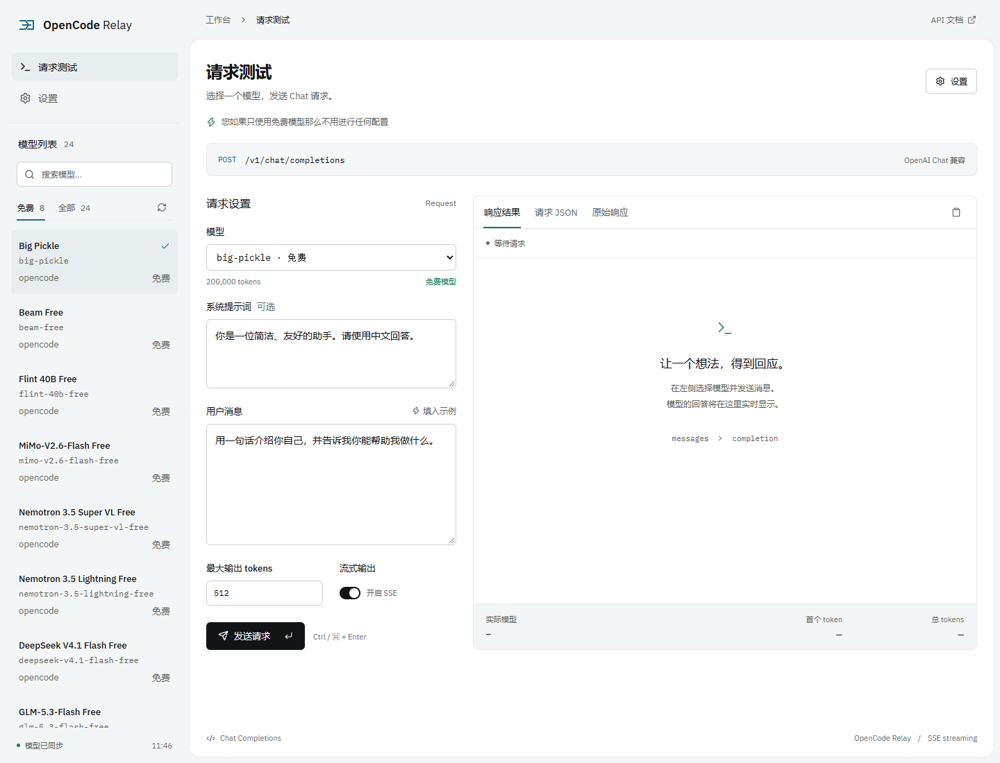
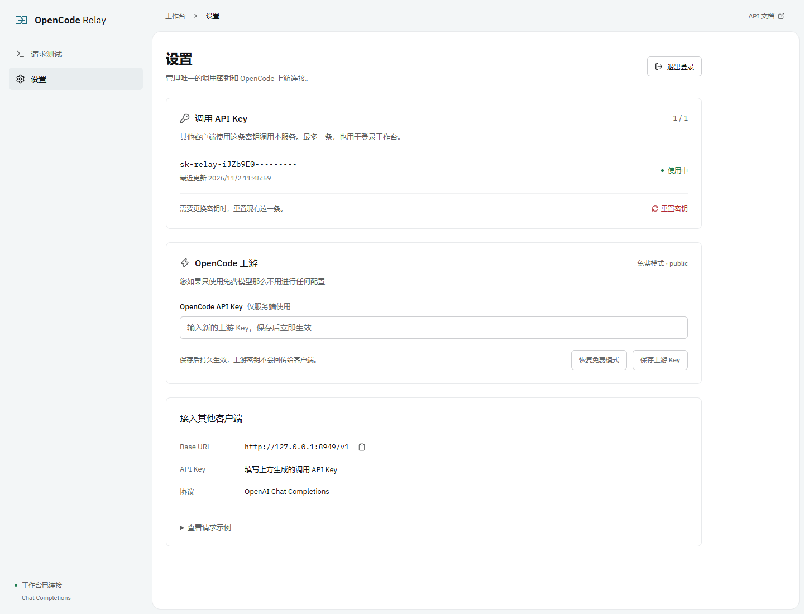

# OpenCode Relay

**Bun 全栈**：单个 `Bun.serve` 进程同时提供原生前端页面与三套兼容接口 —— OpenAI Chat Completions、Anthropic Messages、OpenAI Responses。把 OpenCode 模型接入任何 OpenAI / Anthropic 客户端。

> 只使用免费模型时无需任何配置，启动即可用。

## 功能

- **三套客户端协议**，共用同一个上游：
  - `POST /v1/chat/completions` — OpenAI Chat Completions（SSE 流式与 JSON 响应）
  - `POST /v1/messages` — Anthropic Messages（SSE 事件流，含 `thinking` 块）
  - `POST /v1/responses` — OpenAI Responses（`response.*` 事件流，含 `sequence_number`）
- 实时模型列表，支持免费筛选（`?free_only=true`）、单个模型查询与搜索。
- 模拟 OpenCode 2.x CLI 的线缆指纹，由 Bun 原生 `fetch` 直接发送。
- 网页测试请求，查看回答、思考过程、耗时与 tokens 用量。
- 侧边栏分为「请求测试」和「设置」，Docker Compose 一键部署。
- 页面可配置自己的 API Key，默认免费模型无需配置。
- 仅允许一条调用 API Key；上游 OpenCode Key 单独保存，客户端无需填写。

## 429 说明

上游的 `429 FreeUsageLimitError` 不只表示配额用尽——它同样是"这个请求不像官方客户端"的拒绝，两种情况的报文完全相同。本中继按 OpenCode 2.x CLI 的线缆形状整形请求：

| 维度 | 整形内容 |
| --- | --- |
| User-Agent | `opencode/latest/<version>/cli`（v2 形状，整串匹配） |
| 会话头 | `x-opencode-session` / `x-opencode-session-id` / `x-session-affinity` / `x-session-id` 四头同值 |
| 会话 ID | 慢钟铸造的 `ses_` 形状，内嵌可信的近期时间戳（哈希派生的 1970 日期会被 429） |
| 工具名 | 调用方工具统一改名为 `mcp_<sha256[:12]>`，描述中的空格替换为 NBSP，响应侧还原 |
| 工具集 | 追加官方 13 工具全集（chat 线带 `strict: false`） |
| 系统上下文 | 注入 `<env>` 环境块 + skills 列表；**不注入人设提示词**（见下） |
| 请求体 | 按客户端键序编码，补 `stream_options.include_usage` 与 `max_completion_tokens` |

关于系统提示词的实测结论（2026-11-21，同一会话/请求头/工具集，只改 system 消息）：

| system 消息 | 结果 |
| --- | --- |
| 完整官方 CLI 提示词 | 200 |
| 仅 `<env>` 环境块 | 200 |
| 普通文本（无 `<env>`） | 429 |
| 无 system 消息 | 429 |

闸门读取的是 `<env>` 块，不是人设。因此本中继只注入环境块，调用方自己的 system 提示词原样保留、紧随其后。触发闸门的整形仍会得到 429，这与真实配额耗尽的报文无法区分，属于上游策略。

## 界面



<details>
<summary>API Key 配置</summary>



</details>

## 架构

```text
server/
  index.ts         Bun.serve 入口，HTML imports 打包并提供页面
  app.ts           路由、鉴权、SSE 转发、上游错误映射
  translated.ts    Anthropic Messages / OpenAI Responses 的路由处理器
  upstream.ts      上游 fetch、超时、取消与并发信号量
  store.ts         bun:sqlite：唯一调用 Key、上游 Key、哈希会话
  log.ts           结构化日志（RELAY_LOG_LEVEL 控制）
  protocol/
    assets.ts      官方工具集、<env> 环境块与 skills 列表
    identity.ts    会话 ID 铸造（慢钟时间戳）与 trace 头
    request.ts     OpenCode 身份、请求整形、工具改名与还原
    bridge.ts      协议中立模型：Chat / Anthropic / Responses 编解码
    stream-bridge.ts 上游 Chat SSE → Anthropic / Responses 事件流
    sse.ts         SSE 解析器
    aggregate.ts   SSE 聚合为完整 Chat 响应
  frontend/
    index.html     Bun 直接打包的入口
    src/           原生 TypeScript（无框架）页面与设置页
tests/             bun test：网关、设置、协议、接口规范与 HTTP 语义
```

单进程、单端口：页面、`/api` 与 `/v1` 都由同一个 Bun 服务提供，不需要 FastAPI、uvicorn、Vite 或 nginx。

三套客户端协议共用一条上游 Chat Completions 线缆：请求先解码为协议中立模型（`bridge.ts`），再编码成 Chat 请求并整形；响应侧把上游 SSE 翻译回客户端协议的事件流。

## Docker 部署

```sh
git clone https://github.com/coferkim/Opencode-Relay.git
cd Opencode-Relay
docker compose up -d --build
```

| 入口 | 地址 |
| --- | --- |
| Web / API | http://127.0.0.1:8948 |
| OpenAI Base URL | http://127.0.0.1:8948/v1 |
| Anthropic Base URL | http://127.0.0.1:8948 |
| API 文档 | http://127.0.0.1:8948/docs |

默认仅本机可访问。首次启动请先在设置页创建调用 Key，再开放远程访问（`.env` 设置 `BIND_ADDRESS=0.0.0.0` 并配置 HTTPS）。

## API Key

打开侧边栏 **设置**：

- **调用 API Key**：只能创建一条，完整值仅在创建/重置时提供，请立即复制；重置后旧 Key 和其他登录会话失效。
- **OpenCode API Key**：只在 Web 修改并保存在服务端，付费模型按需配置；「恢复免费模式」使用 `public`。

其他客户端和 Web 登录都使用**调用 Key**，不是 OpenCode Key。网页使用 HttpOnly 会话，无需每次粘贴密钥。
配置持久保存到 Docker 的 `relay-data` 卷，本地为 `data/`；不要删除数据卷或将其提交到 Git。
已有 `.env` 的 `RELAY_API_KEY` 仅在首次初始化时导入，之后以 Web 设置为准。

## API

所有接口使用 `Authorization: Bearer sk-relay-…`（设置页生成的调用 Key）。

### OpenAI Chat Completions

- `GET /v1/models` — 模型列表，支持 `?free_only=true`。
- `GET /v1/models/{model}` — 单个模型，未知模型返回 404。
- `POST /v1/chat/completions` — Chat 请求，`stream: true` 开启 SSE。

```sh
curl http://127.0.0.1:8948/v1/chat/completions \
  -H "Authorization: Bearer sk-relay-…" \
  -H "Content-Type: application/json" \
  -d '{"model":"MODEL_ID","messages":[{"role":"user","content":"你好"}],"stream":true}'
```

### Anthropic Messages

- `POST /v1/messages` — Messages 请求，支持 `stream: true`；`thinking` 请求映射为 reasoning，响应侧输出 `thinking` 块。
- `POST /v1/messages/count_tokens` — 输入 token 估算，返回 `{ "input_tokens": N }`。

```sh
curl http://127.0.0.1:8948/v1/messages \
  -H "Authorization: Bearer sk-relay-…" \
  -H "Content-Type: application/json" \
  -d '{"model":"MODEL_ID","max_tokens":1024,"messages":[{"role":"user","content":"你好"}]}'
```

Anthropic 客户端把 Base URL 设为 `http://127.0.0.1:8948` 即可（SDK 会拼上 `/v1/messages`）。

### OpenAI Responses

- `POST /v1/responses` — Responses 请求，`input` 支持字符串或 item 数组，`stream: true` 输出 `response.*` 事件流。
- `GET /v1/responses/{id}` — 本网关不持久化 response，按规范返回 404 `not_found`。

```sh
curl http://127.0.0.1:8948/v1/responses \
  -H "Authorization: Bearer sk-relay-…" \
  -H "Content-Type: application/json" \
  -d '{"model":"MODEL_ID","input":"你好","stream":true}'
```

错误响应按各自协议的规范信封返回：OpenAI 系为 `{"error":{message,type,param,code}}`，Anthropic 为 `{"type":"error","error":{type,message}}`。外部调用必须提供有效 Key；不接受 `X-OpenCode-API-Key` 覆盖上游配置。

## 配置

| 环境变量 | 默认值 | 说明 |
| --- | --- | --- |
| `PORT` | `8948` | 监听端口 |
| `OPENCODE_API_KEY` | `public` | 上游 Key（免费模型保持 `public`） |
| `OPENCODE_BASE_URL` | `https://opencode.ai/inference/openai/v1` | 上游地址 |
| `OPENCODE_MODELS_URL` | — | 覆盖模型列表地址 |
| `OPENCODE_CLIENT` | `cli` | 上报的客户端名 |
| `OPENCODE_VERSION` | `2.1.1` | 上报的客户端版本 |
| `OPENCODE_TIMEOUT_SECONDS` | `120` | 上游超时 |
| `OPENCODE_MAX_CONCURRENT_REQUESTS` | `8` | 上游并发上限 |
| `RELAY_LOG_LEVEL` | `info` | `debug` / `info` / `warn` / `error` / `off` |
| `RELAY_API_KEY` | — | 首次初始化时导入的调用 Key |
| `RELAY_DATA_DIR` | `./data` | 数据目录 |
| `BIND_ADDRESS` | `127.0.0.1` | Docker 发布地址 |

## 本地运行

需要 Bun 1.4.4+：

```sh
bun install
bun run dev
```

`bun run dev` 使用 Bun 的 HTML imports 与热更新，页面和 API 都在 http://127.0.0.1:8948。

## 测试

```sh
bun test          # 91 项：网关、设置、协议、接口规范、HTTP 语义、翻译接口
bunx tsc --noEmit
```

测试覆盖三套接口的规范符合性（响应 schema、SSE 事件序列、错误信封、鉴权、同源、并发、断连恢复）与请求整形（工具改名、环境块注入、会话 ID 形状）。
