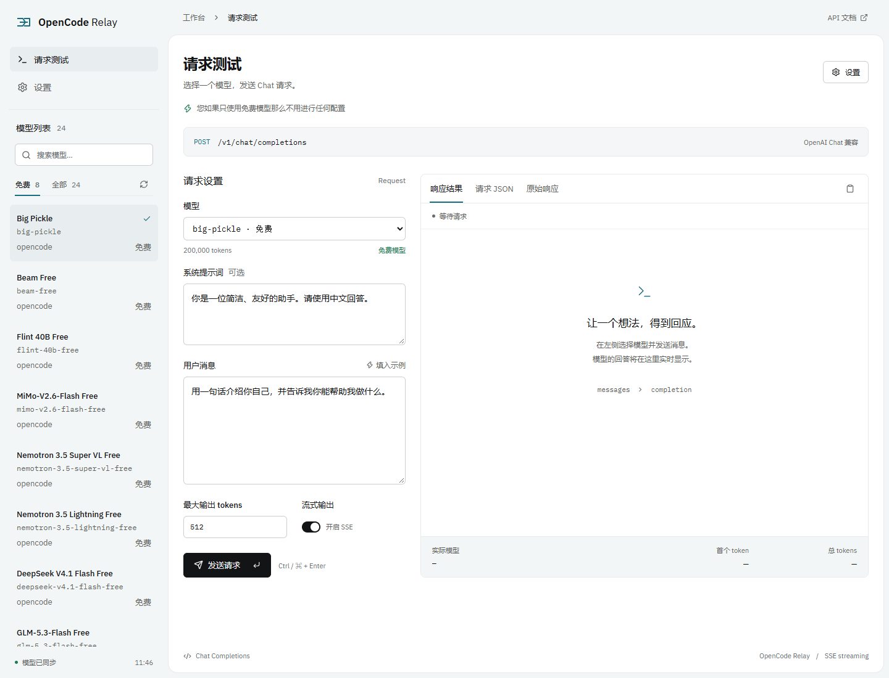
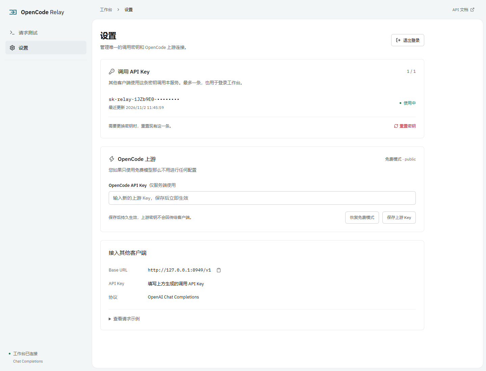

# OpenCode Relay

**FastAPI + Bun + Vue 3**，将 OpenCode 模型接入 OpenAI 兼容的 Chat Completions 接口。

> 您如果只使用免费模型那么不用进行任何配置

## 功能

- 实时模型列表，支持免费筛选、搜索与刷新。
- Chat 协议，支持 SSE 流式与 JSON 响应。
- 模拟 OpenCode 客户端请求头、会话标识与请求格式，由 Bun 原生发送请求。
- 网页测试请求，查看回答、思考过程、耗时与 tokens 用量。
- 页面配置 API Key，Docker Compose 一键部署。

**429 说明：** 实现了客户端协议模拟以此绕过了上游429限制。

## 界面



<details>
<summary>API Key 配置</summary>



</details>

## Docker 部署

```sh
git clone https://github.com/coferkim/Opencode-Relay.git
cd Opencode-Relay
docker compose up -d --build
```

| 入口 | 地址 |
| --- | --- |
| Web | http://127.0.0.1:8948 |
| API Base URL | http://127.0.0.1:8949/v1 |
| API 文档 | http://127.0.0.1:8949/docs |

默认仅本机可访问。远程部署在 `.env` 设置 `BIND_ADDRESS=0.0.0.0`，并配置 `RELAY_API_KEY` 与 HTTPS。

## API Key

点击页面右上角 **API Key 配置**：

- **OpenCode API Key**：付费模型使用；留空沿用服务端配置，默认 `public`。
- **Relay API Key**：网关启用鉴权后填写，与上游 Key 分开。

页面密钥刷新后清除。持久配置请复制 `.env.example` 为 `.env`，修改后执行 `docker compose up -d --force-recreate`。

## API

- `GET /v1/models`：获取可用 Chat 模型。
- `POST /v1/chat/completions`：发送 Chat 请求，`stream: true` 开启流式输出。

OpenAI 兼容客户端填写上面的 Base URL。未启用网关鉴权时 Key 可填任意非空值；启用后填写 `RELAY_API_KEY`。
单次请求指定上游 Key 可添加 `X-OpenCode-API-Key` 请求头。

## 本地开发

安装 Python 3.13、uv、Bun 1.4.4+ 和 Node.js 22.12+：

```sh
uv sync --python 3.13
bun install
bun run dev
```
